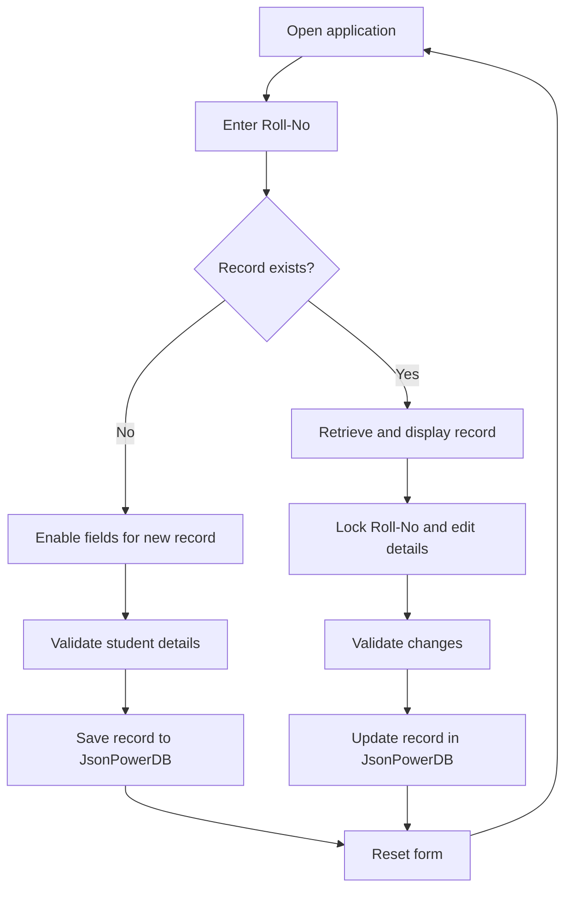

# Student Enrollment Management System — JSONPowerDB

A responsive web application for managing student enrollment records using **JsonPowerDB (JPDB)**. The project was developed as an academic micro-project to demonstrate primary-key-based record lookup, insertion, and updating through the JsonPowerDB APIs.

[](https://login2explore.com/)
[](#technology-stack)
[](LICENSE)

---

## Table of Contents

- [Project Title](#project-title)
- [Description](#description)
- [Database Design](#database-design)
- [Scope of Functionalities](#scope-of-functionalities)
- [Benefits of Using JsonPowerDB](#benefits-of-using-jsonpowerdb)
- [Application Workflow](#application-workflow)
- [Technology Stack](#technology-stack)
- [Project Structure](#project-structure)
- [How to Run the Project](#how-to-run-the-project)
- [Examples of Use](#examples-of-use)
- [Testing and Project Status](#testing-and-project-status)
- [Release History](#release-history)
- [Security Notes](#security-notes)
- [Sources](#sources)
- [License](#license)

---

## Project Title

**Student Enrollment Management System using JsonPowerDB**

## Description

The Student Enrollment Management System is a browser-based application that stores and manages student enrollment details in JsonPowerDB. It connects to the `SCHOOL-DB` database and uses the `STUDENT-TABLE` relation.

The application uses **Roll-No as the primary key**. When a user enters a Roll-No, the application checks whether a matching record already exists:

- If the record does not exist, the user can enter the remaining details and save a new student.
- If the record exists, the application retrieves the stored details and allows the user to update the record without changing its primary key.

The project demonstrates how a lightweight HTML, CSS, and JavaScript frontend can interact with JsonPowerDB using its API and JavaScript helper functions.

## Database Design

| Setting | Value |
|---|---|
| Database name | `SCHOOL-DB` |
| Relation name | `STUDENT-TABLE` |
| Primary key | `Roll-No` |

### Student fields

| Field | Purpose |
|---|---|
| `Roll-No` | Unique student identifier and primary key |
| `Full-Name` | Student's full name |
| `Class` | Student's class or grade |
| `Birth-Date` | Student's date of birth |
| `Address` | Student's residential address |
| `Enrollment-Date` | Date of enrollment |

## Scope of Functionalities

### 1. Primary-key lookup
- Accepts a Roll-No from the user.
- Checks the `STUDENT-TABLE` relation for an existing record.
- Loads the record when the Roll-No is already present.

### 2. Save a new student
- Enables the remaining fields when the Roll-No is not found.
- Validates required fields before submission.
- Inserts the student record into JsonPowerDB.

### 3. Update an existing student
- Retrieves and displays the existing record.
- Keeps the primary-key field locked while editing.
- Updates the existing record using its database record number.

### 4. Reset the form
- Clears entered or retrieved values.
- Returns the form to its initial state.
- Places focus back on the Roll-No field.

### 5. Validation and feedback
- Prevents submission when required fields are empty.
- Validates date input, including rejecting a future birth date.
- Displays success or error feedback based on the operation response.
- Handles connection and authentication errors.

### 6. Database connection settings
- Allows the user to configure a JsonPowerDB connection token.
- Provides a connection-test action.
- Uses the configured database and relation names.

## Benefits of Using JsonPowerDB

JsonPowerDB is used in this project because it provides a JSON-oriented, API-based way to work with application data. Benefits relevant to this project include:

1. **JSON-based data handling:** JavaScript applications can work naturally with JSON request and response data.
2. **API-driven integration:** Database operations can be invoked through HTTP APIs without writing a separate database driver layer in the browser.
3. **Quick application development:** The provided request helpers simplify common operations such as record insertion, retrieval, and update.
4. **Primary-key retrieval:** The application can look up a student using the unique `Roll-No` field.
5. **Flexible data representation:** JSON documents are convenient for representing student records with named fields.
6. **Lightweight frontend integration:** JsonPowerDB can be used from a small HTML, CSS, and JavaScript project.

These are the reasons JsonPowerDB is suitable for demonstrating database integration in this micro-project; they are not a benchmark comparison against other database systems.

## Application Workflow

1. The page opens with an empty form. Only the Roll-No field is enabled and focused.
2. The user enters a Roll-No and triggers lookup.
3. If no record is found, the remaining fields and Save/Reset actions are enabled.
4. If a record is found, its details are displayed, Roll-No is locked, and Update/Reset actions are enabled.
5. After a successful Save or Update, the form returns to its initial state.



## Technology Stack

| Technology | Purpose |
|---|---|
| HTML5 | Form structure and page content |
| CSS3 | Responsive layout and visual styling |
| JavaScript | Form state, validation, and application logic |
| jQuery | AJAX and DOM utilities used by the application |
| JsonPowerDB | Student record storage and database operations |
| JPDB JavaScript helper | Request construction and command execution |
| Node.js test runner | Automated QA checks |
| Playwright | Browser end-to-end testing |
| Git and GitHub | Version control and source publication |

## Project Structure

```text
student-enrollment-jpdb/
├── index.html
├── css/
│   └── style.css
├── js/
│   ├── app.js
│   ├── config.example.js
│   └── jpdb-commons.js
├── assets/
│   └── icon.svg
├── tests/
│   ├── playwright-e2e.js
│   ├── test-runner.js
│   └── test-suite.html
├── README.md
├── .gitignore
└── LICENSE
```

## How to Run the Project

### 1. Clone the repository

```bash
git clone https://github.com/ArjunReddyVelma/student-enrollment-jpdb.git
cd student-enrollment-jpdb
```

### 2. Start a local web server

Using Python:

```bash
python3 -m http.server 8000
```

### 3. Open the application

Visit [http://localhost:8000](http://localhost:8000) in your browser.

### 4. Configure JsonPowerDB

1. Open **Database Settings** in the application.
2. Enter your own JsonPowerDB connection token.
3. Confirm the base URL is `https://api.login2explore.com:5577`.
4. Confirm the database is `SCHOOL-DB` and the relation is `STUDENT-TABLE`.
5. Select **Test Connection**, then save the settings if the test succeeds.

You must have a valid JsonPowerDB account and permission to access the configured database and relation. Do not use a token copied from this README or commit your own token to the repository.

## Examples of Use

### Add a new student

After entering a Roll-No that is not already present, complete the form. A student record has this shape:

```json
{
  "Roll-No": "101",
  "Full-Name": "Aditi Sharma",
  "Class": "10-A",
  "Birth-Date": "2009-04-12",
  "Address": "Jaipur, Rajasthan",
  "Enrollment-Date": "2026-11-16"
}
```

The application validates the fields and sends the insert request to JsonPowerDB.

### Update a student

Enter a Roll-No that already exists. The application retrieves the record and fills the form. Edit the permitted fields and select **Update**. The Roll-No remains unchanged.

## Testing and Project Status

**Project status: Implemented; QA and database integration tests are reported as completed.**

The engineering report for the latest code revision records the following results:

| Test suite | Assertions/tests passed | Failed |
|---|---:|---:|
| Playwright browser end-to-end suite | 19 | 0 |
| Node.js headless QA suite | 15 | 0 |
| **Total** | **34** | **0** |

The reported test coverage includes:
- Initial form state and keyboard focus.
- Database settings modal and token masking.
- JPDB connection and invalid-token handling.
- New and existing Roll-No lookup workflows.
- Student insertion and retrieval.
- Student update and retrieval of updated values.
- Reset and required-field validation.
- Network failure handling.
- Browser console checks.
- Responsive layouts at desktop, laptop, tablet, and mobile viewport sizes.

The latest engineering report records a successful JPDB connection, authentication, insert, lookup, and update test. Test results describe the reported test run and may depend on the availability of the JPDB service and valid credentials.

To run the local QA suite:

```bash
node tests/test-runner.js
```

To run the Playwright suite, install the project's required test dependencies if they are not already installed, then run:

```bash
node tests/playwright-e2e.js
```

## Release History

The following history summarizes the project's GitHub development milestones. These are development releases represented by commits; they do not imply that GitHub Release objects or version tags were created.

| Milestone | Commit | Changes |
|---|---|---|
| Repository foundation | `4b7404a` | Initialized the Student Enrollment project repository. |
| Initial UI | `765b2f3` | Added the responsive enrollment form and interface. |
| JsonPowerDB integration | `7352056` | Added JPDB database operations and application integration. |
| QA and workflow verification | `c7fd212` | Added tests and verified enrollment workflows. |
| Documentation | `6aaf0a9` | Added project setup and usage documentation. |
| Connection fixes and final QA | `da1ca0e` | Fixed the reported JPDB connection issues, improved response handling, and added Playwright end-to-end coverage. |

**Latest reported commit:** `da1ca0e6d815c09746fa67f9e3150b904b7465da)

**Repository:** [github.com/ArjunReddyVelma/student-enrollment-jpdb](https://github.com/ArjunReddyVelma/student-enrollment-jpdb)

## Security Notes

- Never commit a real JsonPowerDB connection token, password, or private configuration file.
- Keep local credentials in an ignored configuration file or enter them through the application's settings interface.
- A browser-based application that sends a token directly to a database API cannot keep that token secret from a user who can inspect browser storage or network requests.
- For a production deployment requiring stronger credential protection, route database requests through a backend service and keep the token on the server.
- Use test records for demonstrations and avoid modifying real student data.

## Sources

- [JsonPowerDB / Login2Xplore](https://login2explore.com/)
- [JsonPowerDB Documentation](https://login2explore.com/jpdb/docs.html)
- [Project GitHub Repository](https://github.com/ArjunReddyVelma/student-enrollment-jpdb)

## License

This project is distributed under the MIT License. See [LICENSE](LICENSE) for details.
