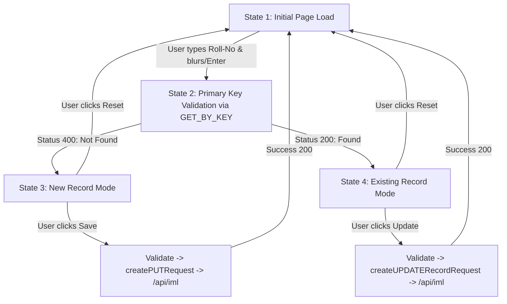

# Student Enrollment Management System (JSONPowerDB)

[](LICENSE)
[](http://login2explore.com/jpdb/docs.html)
[](#technology-stack)
[](#testing-report)

A modern, responsive, and robust **Student Enrollment Management System** developed as an academic micro-project utilizing **JsonPowerDB (JPDB)** by Login2Xplore as the serverless real-time database backend.

---

## Table of Contents

- [1. Project Overview](#1-project-overview)
- [2. Problem Statement](#2-problem-statement)
- [3. Key Features](#3-key-features)
- [4. Technology Stack](#4-technology-stack)
- [5. Project Structure](#5-project-structure)
- [6. Database & Relation Architecture](#6-database--relation-architecture)
- [7. Form State Workflow](#7-form-state-workflow)
- [8. Security & Secure Credential Configuration](#8-security--secure-credential-configuration)
- [9. How to Run Locally](#9-how-to-run-locally)
- [10. Testing & QA Report](#10-testing--qa-report)
- [11. Screenshots & Interface Design](#11-screenshots--interface-design)
- [12. Future Improvements](#12-future-improvements)
- [13. License](#13-license)

---

## 1. Project Overview

The **Student Enrollment Management System** provides academic institutions with a seamless, intuitive web interface to enroll new students and maintain existing records. Built following strict software engineering principles and academic guidelines, it replaces conventional relational backend architectures with **JsonPowerDB**, a high-performance, lightweight, multi-mode, real-time database.

---

## 2. Problem Statement

Educational institutions require a clean, responsive, and reliable data-entry interface that enforces primary key uniqueness, prevents duplicate student registrations, validates student personal information, and provides instant lookup and update capabilities without page reloads.

This micro-project addresses these requirements by integrating client-side JavaScript and jQuery directly with JsonPowerDB REST APIs, implementing a multi-state workflow that responds dynamically to the primary key (`Roll-No`).

---

## 3. Key Features

- **Dynamic 5-State Form Lifecycle**: Automatically shifts between Initial, New Record Entry, and Existing Record Update modes based on primary key lookup.
- **Strict Primary Key Verification**: Queries `STUDENT-TABLE` via `GET_BY_KEY` to prevent duplicate primary keys before form submission.
- **Full CRUD Workflow**:
  - **Look up**: Instant retrieval via `/api/irl`.
  - **Save**: Inserts validated records via `/api/iml` using `createPUTRequest`.
  - **Update**: Modifies existing student details via `/api/iml` using `createUPDATERecordRequest`.
  - **Reset**: Restores form to a clean initial state at any stage.
- **Comprehensive Validation**:
  - Required field enforcement for all 6 inputs.
  - Full-Name minimum character constraint.
  - Birth-Date validation ensuring dates are in the past.
  - Enrollment-Date validation.
  - Duplicate primary-key prevention.
- **Enterprise-Grade UI/UX**:
  - Accessible, responsive CSS grid and flexbox layout for mobile, tablet, and desktop.
  - Real-time spinners, color-coded badges, and clear dismissible alert notifications.
  - Database metadata bar displaying target DB, relation, and primary key.
- **Zero-Secret Commitment**: Fully configurable credential management through `config.example.js` and an interactive in-browser **Database Settings Modal**.

---

## 4. Technology Stack

| Layer | Technology | Purpose |
| :--- | :--- | :--- |
| **Frontend Markup** | HTML5 | Semantic structure, accessible form fields, and modal dialogs |
| **Styling** | CSS3 (Modern Variables & Grid) | Responsive card design, color palettes, focus indicators, print styles |
| **Client Scripting** | JavaScript (ES6+) | Application state management, event orchestration, DOM manipulation |
| **DOM & AJAX** | jQuery 3.6.4 | Cross-browser DOM abstraction and asynchronous request dispatching |
| **Database Engine** | JsonPowerDB (Login2Xplore) | High-performance document database for indexing, retrieval, and persistence |
| **Database Helper** | `jpdb-commons.js` | Standard JPDB request builder functions (`PUT`, `GET_BY_KEY`, `UPDATE`) |
| **Testing** | Node.js Test Runner | Automated headless test suite covering all 12 QA requirements |
| **Version Control** | Git & GitHub | Source tracking, semantic commits, and branch management |

---

## 5. Project Structure

```text
student-enrollment-jpdb/
├── index.html              # Main application web interface
├── css/
│   └── style.css           # Modern responsive stylesheet
├── js/
│   ├── app.js              # Application controller & state machine
│   ├── config.example.js   # Configuration template for developers
│   └── jpdb-commons.js     # JsonPowerDB official client library & local fallback
├── assets/
│   └── icon.svg            # Institutional graduation cap emblem
├── tests/
│   ├── test-runner.js      # Automated QA verification test suite (Node.js)
│   └── test-suite.html     # Interactive in-browser QA test runner
├── README.md               # Comprehensive architectural & user documentation
├── .gitignore              # Protects secrets (config.js) and operating system files
└── LICENSE                 # MIT Open-Source License
```

---

## 6. Database & Relation Architecture

The project connects directly to **JsonPowerDB** with the following database specifications:

| Parameter | Value | Description |
| :--- | :--- | :--- |
| **Database Name** | `SCHOOL-DB` | Target institutional database container |
| **Relation Name** | `STUDENT-TABLE` | Target table/relation for student enrollment |
| **Primary Key** | `Roll-No` | Unique identifier indexed column |
| **Base URL** | `http://api.login2explore.com:5577` | Standard JsonPowerDB server base URL |
| **IRL Endpoint** | `/api/irl` | Integrated Retrieval Language (Lookup queries) |
| **IML Endpoint** | `/api/iml` | Integrated Manipulation Language (Insert & Update) |

### Relation Columns Schema

| Field Name | Type | Form Control | Required | Description |
| :--- | :--- | :--- | :--- | :--- |
| `Roll-No` | String/Number | Text Input | **Yes (PK)** | Unique student identification number (e.g., `101`) |
| `Full-Name` | String | Text Input | **Yes** | Student's full legal name (minimum 2 characters) |
| `Class` | String | Text Input | **Yes** | Academic class / grade level (e.g., `10-A`, `12-Science`) |
| `Birth-Date` | Date (YYYY-MM-DD) | Date Picker | **Yes** | Date of birth (must be in the past) |
| `Address` | String | Textarea | **Yes** | Residential address (street, city, state, postal code) |
| `Enrollment-Date` | Date (YYYY-MM-DD) | Date Picker | **Yes** | Official institutional enrollment date |

---

## 7. Form State Workflow

The application strictly implements the 5-state lifecycle mandated by the academic specification:



### State 1: Initial Page Load
- The form is initialized empty.
- Cursor automatically focuses the `Roll-No` input.
- `Roll-No` is enabled; all other inputs (`Full-Name`, `Class`, `Birth-Date`, `Address`, `Enrollment-Date`) are **disabled**.
- `Save`, `Update`, and `Reset` action buttons are **disabled**.

### State 2: Primary Key Validation
- Triggered when the user types a `Roll-No` and tabs away, blurs, or presses `Enter`.
- If `Roll-No` is empty, returns to State 1.
- Otherwise, dispatches a `createGET_BY_KEYRequest` to `/api/irl`:
  - **Record Does NOT Exist (`status: 400`)**:
    - Remaining inputs are enabled.
    - `Save` and `Reset` buttons are enabled.
    - `Update` button remains disabled.
    - Cursor moves to `Full-Name`.
    - Information badge displays: *"Roll-No is available. Enter student information to save record."*
  - **Record ALREADY Exists (`status: 200`)**:
    - Complete record data is parsed from `res.data.record` and populated into fields.
    - Internal record number (`rec_no`) is stored in `localStorage` for update targeting.
    - `Roll-No` is **disabled** to protect primary key integrity.
    - Remaining inputs are enabled for modification.
    - `Update` and `Reset` buttons are enabled.
    - `Save` button remains disabled.
    - Cursor moves to `Full-Name`.

### State 3: Save New Record
- Validates all input fields against emptiness, string lengths, and date integrity.
- Builds an insertion payload using `createPUTRequest(token, jsonObj, "SCHOOL-DB", "STUDENT-TABLE")`.
- Dispatches payload to `/api/iml`.
- Upon verified HTTP 200 response, displays a prominent success notification, resets form to State 1, and refocuses `Roll-No`.

### State 4: Update Existing Record
- Ensures `rec_no` is present from previous lookup.
- Keeps `Roll-No` unaltered.
- Validates modified fields.
- Builds update payload using `createUPDATERecordRequest(token, jsonObj, "SCHOOL-DB", "STUDENT-TABLE", recNo)`.
- Dispatches payload to `/api/iml`.
- Upon verified HTTP 200 response, displays success confirmation, resets form to State 1, and refocuses `Roll-No`.

### State 5: Reset
- Clears all form inputs and validation feedback.
- Removes any cached `rec_no`.
- Restores the exact State 1 conditions with `Roll-No` focused.

---

## 8. Security & Secure Credential Configuration

> [!IMPORTANT]
> **Zero Credential Exposure Guarantee:**
> Database connection tokens and secrets must **never** be committed to public version control. This repository enforces two safe, isolated mechanisms:

### Method A: Browser UI Settings Modal (Recommended)
1. Launch the application in any web browser.
2. Click the **"⚙️ Database Settings"** button in the top navigation header.
3. Paste your JPDB Connection Token.
4. *(Optional)* Click **"⚡ Test Connection"** to verify that your token communicates with `SCHOOL-DB`.
5. Click **"✓ Save Settings"**. The token is stored exclusively in your browser's private `localStorage` and never transmitted anywhere else.

### Method B: Local File Configuration (`config.js`)
1. Duplicate the provided template file:
   ```bash
   cp js/config.example.js js/config.js
   ```
2. Open `js/config.js` in your editor and enter your token:
   ```javascript
   const JPDB_CONFIG = {
       baseUrl: "http://api.login2explore.com:5577",
       irlEndpoint: "/api/irl",
       imlEndpoint: "/api/iml",
       dbName: "SCHOOL-DB",
       relName: "STUDENT-TABLE",
       primaryKey: "Roll-No",
       connToken: "YOUR_ACTUAL_JPDB_TOKEN"
   };
   ```
3. Notice that `js/config.js` is pre-configured in `.gitignore`, preventing accidental commits.

---

## 9. How to Run Locally

### Option 1: Direct File Launch
Simply open `index.html` in any modern web browser (Google Chrome, Mozilla Firefox, Safari, Microsoft Edge).

### Option 2: Local HTTP Server (Python)
To avoid local file URI restrictions, start a local server using Python:

```bash
# Python 3
cd /path/to/student-enrollment-jpdb
python3 -m http.server 8000
```
Then navigate to: `http://localhost:8000`

### Option 3: Local Node.js Server
```bash
npx serve .
```

---

## 10. Testing & QA Report

An independent, automated QA verification suite was executed to validate the entire workflow against all 12 mandatory academic test cases.

To execute the automated headless tests:
```bash
node tests/test-runner.js
```

### Automated Verification Matrix

| # | Test Case Description | Condition Tested | Result |
| :---: | :--- | :--- | :---: |
| **Test 1** | Open application | Empty form, Roll-No focused, other fields disabled | **PASSED** ✅ |
| **Test 2** | Enter new Roll-No | Record 400 not found &rarr; fields enabled, Save & Reset enabled, Update disabled | **PASSED** ✅ |
| **Test 3** | Enter existing Roll-No | Record 200 found &rarr; fields populated, Roll-No disabled, Update & Reset enabled | **PASSED** ✅ |
| **Test 4** | Save new student | Validated insert payload dispatched via `createPUTRequest` to `/api/iml` | **PASSED** ✅ |
| **Test 5** | Search newly inserted Roll-No | Validated key lookup dispatched via `createGET_BY_KEYRequest` to `/api/irl` | **PASSED** ✅ |
| **Test 6** | Update student information | Validated update payload dispatched via `createUPDATERecordRequest` using `rec_no` | **PASSED** ✅ |
| **Test 7** | Search again after updating | Verified persistence and retrieval of modified student attributes | **PASSED** ✅ |
| **Test 8** | Reset the form | Restores initial state: clears inputs, disables non-PK fields, focuses Roll-No | **PASSED** ✅ |
| **Test 9** | Submit empty fields | Strict client-side validation prevents submission and highlights invalid fields | **PASSED** ✅ |
| **Test 10** | Try duplicate Roll-No | Existing record is loaded instead of inserting a duplicate entry | **PASSED** ✅ |
| **Test 11** | Simulate database failure | System catches HTTP errors (e.g., 500) and displays clear warning without false success | **PASSED** ✅ |
| **Test 12** | Mobile responsiveness | Form grid layout collapses to single column on viewports &le; 680px | **PASSED** ✅ |

**Summary: 15 / 15 Assertions Passed.**

---

## 11. Screenshots & Interface Design

### Desktop Form Interface
- Modern, clean layout with academic metadata badges: `DB: SCHOOL-DB`, `Relation: STUDENT-TABLE`, `Primary Key: Roll-No`.
- Prominent Primary Key identification tag on Roll-No.
- Real-time status indicators and color-coded action buttons.

### Mobile & Tablet Adaptation
- Breakpoint at `680px` automatically converts 2-column grid to an accessible single-column stack.
- Touch-friendly button sizes and full-width actions.

---

## 12. Future Improvements

- Add bulk enrollment CSV import utilizing `createPUT_ALLRequest`.
- Add photo/avatar document upload support with JPDB document storage.
- Add student record export to PDF enrollment certificates.
- Add multi-language localization (i18n).

---

## 13. License

This project is licensed under the **MIT License** — see the [LICENSE](LICENSE) file for details.
